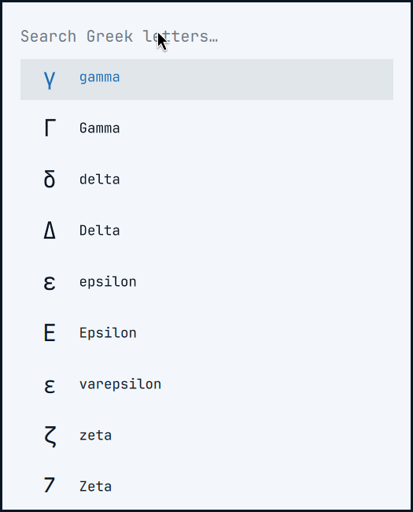

# Greek letters

Search and type Greek letters from the Omarchy shell, the same way the emoji picker works.

It is meant for maths, physics, and engineering. Lowercase, capitals, and the usual variants are all in one list: type `epsilon` and you get ε epsilon, Ε Epsilon, and ϵ varepsilon.

<p align="center">
  
</p>

## Install

```sh
omarchy plugin add https://github.com/LucasDaRY/Greek-Letters-Picker.git --enable
```

That clones the plugin and enables it. It does not change your keybindings or any other config.

## Open it

Bind a key in `~/.config/hypr/bindings.lua`. Super+Ctrl+E is the emoji picker, so Super+Ctrl+G is a free chord on a default install:

```lua
o.bind("SUPER + CTRL + G", "Greek letters", { panel = "lucas.greek" })
```

If that chord is already taken, check `omarchy menu keybindings --print` and use `o.rebind` instead of `o.bind`. Hyprland reloads on save. Confirm with `hyprctl reload` and `hyprctl configerrors`.

You can also open and close it without a key:

```sh
omarchy-shell shell toggle lucas.greek
```

The overlay pops in immediately if you give its layer the same no-animation rule as the emoji picker. This is optional, in `~/.config/hypr/hyprland.lua`:

```lua
hl.layer_rule({ match = { namespace = "^lucas-greek$" }, no_anim = true, animation = "none" })
```

## Search

Type the start of a name. Capitals do not matter.

| Type | You get |
| --- | --- |
| `delt` | δ delta, Δ Delta |
| `epsilon` | ε epsilon, Ε Epsilon, ϵ varepsilon |
| `phi` | φ phi, Φ Phi, ϕ varphi |
| `sigma` | σ sigma, Σ Sigma, ς varsigma |

The same pattern covers vartheta, varkappa, varpi, and varrho. `mu` also finds µ micro, `omega` also finds Ω ohm, and `nabla` finds ∇.

Arrow keys move through the list. Home and End jump to the ends. Enter, or a click, types the letter into the focused window and closes the dialog. Escape clears the query first, then closes the dialog.

Typing uses Omarchy's own emoji insert command, so the letter goes in the same way an emoji does. Nothing else has to be installed.

## Remove

Delete the keybinding and the layer rule if you added them, then:

```sh
omarchy plugin remove lucas.greek
```

## License

MIT. See [LICENSE](LICENSE).

There are no extra dependencies. The plugin runs inside `omarchy-shell` and only shells out to `omarchy-menu-emoji-insert`, which ships with Omarchy, to paste the letter you picked.
